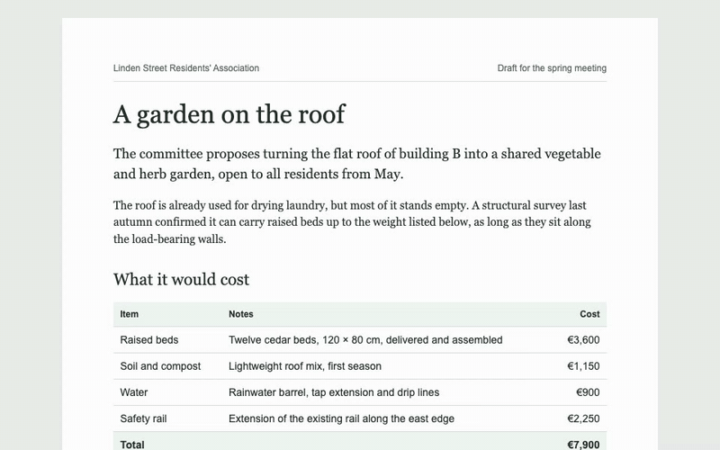

# Pearwrite

[](https://github.com/jonasjancarik/pearwrite/actions/workflows/ci.yml)

**Write with your coding agent without breaking your flow.**



Coding agents have become good at writing documents as hand-crafted HTML: reports, proposals, handouts, meeting packets, with real typography, tables, charts and print layouts. Working on them together is still awkward. To change a word, you either edit raw markup or describe the change to the agent and wait. And as soon as you open the page in a rich-text editor, it rewrites the HTML into its own format and the layout falls apart.

Pearwrite takes a different approach. It serves your HTML file exactly as it is and lets you click into the rendered page and type. Your change goes into that one paragraph, cell or heading, and the rest of the file stays exactly as it was. Your agent sees each edit as you make it, so when you change an amount it can fix the total. For anything bigger, such as rewording a section, adding a row or fixing a chart, you select the text or point at the element, leave a comment on the page, and the agent edits the file. Every open page reloads as soon as the file changes and briefly highlights what the agent changed, so you always see the current version and where it differs.

```bash
npx github:jonasjancarik/pearwrite report.html
```

## Why it works this way

- **Your edits are surgical.** Typing changes the text inside one paragraph, heading, list item or table cell, and nothing else. CSS, SVG charts, print styles and the rest of the markup stay byte-for-byte as they were, so `git diff` shows exactly what you changed.
- **The agent sees what you changed.** Pearwrite prints a line for every edit you make on the page, so an agent running it in the background can catch, say, a changed amount and fix the total that depends on it.
- **You and the agent can work at the same time.** Edits to different blocks never get in each other's way, and edits to different words of the same paragraph are combined. If you both change the same words, the document keeps the agent's version and yours is set aside on the page, where you can compare the two and pick one. The agent is told too, so it can combine them for you.
- **The HTML file is the document.** There's no separate editor format, database or export step. What you see in the browser is the file on disk, and what you print or send is that same file.
- **Comments point at the right place.** Pearwrite gives every block a stable `data-id`. When you comment on an element, the agent receives that id and finds the exact spot in the file, even if the wording has changed since.

## Getting started

You need Node.js 22 or newer. Install the agent skill with the [skills CLI](https://skills.sh):

```bash
npx skills add jonasjancarik/pearwrite
```

Then tell your agent, such as Claude Code or Codex, that you want to work on a document together in Pearwrite, for example: "Let's work on report.html together in pearwrite." The agent starts Pearwrite and opens the page in its built-in browser. Click into any paragraph, heading, list item or table cell to type, and leave a comment on the page when you want the agent to change something.

To try it without a document of your own, give your agent this prompt:

```text
Download https://raw.githubusercontent.com/jonasjancarik/pearwrite/main/examples/garden-proposal.html into this folder and open it in Pearwrite. Briefly tell me how we can work on it together.
```

The skill tells the agent how to start Pearwrite. The detailed instructions, such as how to find a commented element by its `data-id`, keep the ids intact, and check totals and charts after you change a number, come from Pearwrite itself (`pearwrite guide`, or the first `open_document` call over MCP), so they always match the version that runs, even if the installed skill is older.

### Running it yourself

You can also start Pearwrite without an agent and open `http://localhost:8765/` in any browser:

```bash
npx github:jonasjancarik/pearwrite path/to/document.html
```

The first run takes a little longer while npm downloads and builds it. Pearwrite writes to the file it serves, so to try it on the example, copy it first:

```bash
cp examples/garden-proposal.html /tmp/ && npx github:jonasjancarik/pearwrite /tmp/garden-proposal.html
```

## What you can and can't edit on the page

You can change the text of any paragraph, heading, list item, table cell, caption or text box. Enter leaves the block (Shift+Enter adds a line break), and pasted text arrives as plain text so it doesn't bring stray formatting along.

**Formatting.** Select some text and a small toolbar appears with bold, italic, strikethrough, code and link. The same works from the keyboard:

| | Shortcut | Or type |
| --- | --- | --- |
| Bold | ⌘B / Ctrl+B | `**bold**` |
| Italic | ⌘I / Ctrl+I | `*italic*` or `_italic_` |
| Strikethrough | ⌘⇧X / Ctrl+Shift+X | `~~struck~~` |
| Code | ⌘E / Ctrl+E | `` `code` `` |
| Link | ⌘K / Ctrl+K | |

The toolbar also turns a paragraph into a heading (H1–H3) or back. Typing `#`, `##` or `###` and a space at the start of a paragraph does the same. The formatting is written as plain HTML (`<strong>`, `<em>`, `<s>`, `<code>`, `<a>`), so the document's own styles decide how it looks. A link can go to a web page, an email address or a phone number (`http`, `https`, `mailto` or `tel`), or to another place in the document; Pearwrite adds `https://` or `mailto:` when you type just a domain or an email address. If the page's own styles make links look like plain text, as CSS resets such as Tailwind's do, links are underlined while you edit, so you can see them; the file isn't changed.

**Adding and removing.** Enter in a paragraph, heading or list item starts a new one, and if the caret is in the middle of the text, the rest of it moves to the new one. After a heading you get a paragraph. Hover over a block or table row and click the + beside it to add one below; a new row has the same cells as the others, empty. To get rid of a paragraph, item or row, delete its text and press Backspace once more. Only empty elements can be removed this way, so text is never thrown away by accident.

A new element copies how its neighbours are written: the same tag, classes and other attributes as most of its siblings, so it looks like them without bringing any markup of its own. After an introduction paragraph with a special class, the next paragraph looks like the ordinary ones, and a new table row looks like the other item rows, not the totals row. Enter in a table cell or caption still just leaves it.

**Moving things.** Hover over a paragraph, heading, list item, table row, figure or section and a handle (⋮⋮) appears to its left; drag it to put the element somewhere else among its neighbours. A list item stays in its list and a row in its table. When elements are nested, such as a row inside a table, each gets its own handle. In the file, the element's markup is moved as it is, with nothing else changed.

**Undoing.** If something lands in the wrong place, click Undo in the message that appears, or press ⌘Z (Ctrl+Z on Windows and Linux). The same works right after you add or remove a paragraph, item or row, or turn a paragraph into a heading or back. Once you've typed something, ⌘Z undoes the typing first, as usual. Your moves, additions, removals and heading changes also have an Undo button in the list of changes, as long as the elements around them are still there, and a new paragraph only while it's empty. If nothing else has changed in the file since, it goes back to exactly what it was.

Everything else structural is the agent's job: adding sections, figures, tables or lists, removing anything that still has content, moving something into a different list or section, changing styles or layout, and anything inside SVG charts. Tables, rows, lists, figures and charts can't be typed into as a whole, but they have ids too, so you can comment on them.

To keep part of a document out of reach on the page, for example figures that are calculated from data, add `data-locked` to the element. It can't be typed into or moved, but it can still be commented on. Text that the page's own scripts fill in, such as a total added up from a table, is kept out of reach automatically: hovering over it explains that your agent has to change it.

## Reviewing what the agent changed

Your agent edits the file directly, so its changes are already in the document when the page reloads. Each block it changed gets a thin blue bar in the left margin until you've looked at it. Point at the block and Keep and Undo appear beside it; hovering a changed word shows the word it replaced. The list of changes (the Pearwrite button at the bottom left) has all of them at the top, under "Your agent's changes to review", with Keep and Undo for each and Keep all.

With the caret in a block your agent changed, ⌥⇧K (Alt+Shift+K on Windows and Linux) keeps the change and ⌥⇧U (Alt+Shift+U) undoes it, without reaching for the buttons. Screen readers hear what was kept or undone.

Keep only takes the change off the list. Undo puts back what was there before the agent's first change to the block: its old text, or a removed or moved block in its old place, and a block the agent added is removed again. If you've typed in the block since, only the agent's words are undone and yours stay; when your edit and the agent's touch the same words, the undo is refused and the page says why. A block the agent added can only be removed this way while nobody has changed it.

Several changes by the agent to the same block count as one, and so does everything inside a new table or list. An undo is written as your own edit, so your agent sees which changes you didn't want and knows not to make them again. The list of changes to review is kept beside the document, not in it, so it's still there after a restart, and the bars are never printed.

To print or send on the document as it was before the changes you haven't decided on yet, click **Print** or **Download** next to "A copy without these changes" in the list. The copy has every one of them undone, but the file keeps them, and they stay on the list. If some can't be undone, because they're too large or you've since edited the same words, the list names them, so you know the copy still has them.

## Comments

For a change you'd rather leave to the agent, select the text it's about and click **Comment** in the toolbar that appears, or press ⌘⌥M / Ctrl+Alt+M. Write what should change and press Enter (Shift+Enter starts a new line). For a chart, figure, table, row or list as a whole, hover over it and click the **Comment** button next to it.

The commented text gets a yellow highlight and the element a small numbered marker; click either to read, edit or delete the comment. The list of changes behind the corner button shows all comments at the top, with whether the agent has dealt with them yet. When it has, the comment is marked done, its highlight goes away, and any note the agent left is shown under it. Done comments stay in the list until you clear them. If the agent or you change the text a comment was about, the comment stays and says so.

Comments are kept outside your document, in Pearwrite's own folder (`~/Library/Application Support/pearwrite` on macOS, `~/.local/state/pearwrite` on Linux, `%LOCALAPPDATA%\pearwrite` on Windows, or `$PEARWRITE_STATE_DIR`), so they survive a restart of Pearwrite and never end up in the HTML. They stay with the document when you move or rename it, and a copy of the document starts with a copy of them. Comments on a document nobody has opened for 90 days are deleted. When Pearwrite starts on a document that still has open comments, it tells the agent, so they're picked up even by a different agent than the one you left them for. They reach the agent the same way your edits do (see below), and it marks them done with `pearwrite resolve` or the `resolve_comment` tool.

The agent can comment too. When it notices something that's for you to decide, such as a figure that doesn't match the project's data or a claim its sources don't back up, it leaves a comment instead of changing your text. Its comments have a blue highlight and marker, and a short notice tells you when one arrives. When it asks a question, it can suggest a few answers that you pick with one click, or you can write your own. Answer one to tell the agent what to do, or dismiss it if nothing needs to change; either way the agent finds out.

This works in any browser, also on a tablet or for other people on your network. If your agent's own browser has a comment tool, as Claude's and Codex's do, you can keep using that too.

### Tagging comments (optional)

When you leave many comments at once, Pearwrite can tag each one with the kind of change it asks for: a small fix, a rewrite, content, a question or layout. The agent then sees, for example, `comment #3 (small fix)` and can group similar requests and make all the small fixes in one go. The tags come from [Jev](https://docs.typesafe.ai/api), a fast classification model from TypeSafe AI, so you need your own TypeSafe API key. Without one, nothing changes and nothing is sent anywhere.

To turn it on, set the key before starting pearwrite:

```bash
export PEARWRITE_JEV_KEY=your-typesafe-key
```

With the key set, every comment you leave, the words you selected and the text of the element it's on are sent to TypeSafe's servers. Your document as a whole isn't sent, and neither are the agent's comments or your answers to them. Pearwrite says when tagging is on as it starts. To leave it off for one document while the key is set, start Pearwrite with `--no-tags`.

Tags are only a hint for the agent. If Jev is less than 80% sure, doesn't answer within two seconds or can't be reached, the comment simply has no tag, and the agent still reads every comment in full.

## What Pearwrite changes in your file

The first time the page is opened, Pearwrite adds a `data-id` attribute to each block and container that doesn't have one yet:

```html
<p data-id="p-3">Raised beds are shared by floor.</p>
<table data-id="table-1">…</table>
```

It also adds one line at the start of the head, `<meta name="pearwrite-id" content="…">`, which names the document so its comments and the rest of what Pearwrite keeps beside it follow it when you move or rename the file.

The ids don't affect how the page looks or prints. Existing ids are never changed, and new elements get one the next time the page is opened. If the document is under version control, commit this change on its own so later diffs stay readable. Use `--no-write-ids` if the file mustn't be changed this way; blocks without an id then can't be edited, and comments are found by the file's path, so they don't follow it when it's moved.

Apart from the ids and that line, the file only changes when you make a change on the page, and then only in the block you typed in or the element you moved.

## How the agent finds out about your edits

For a diagram of how one edit travels from the page to your agent and back, see [How Pearwrite works](https://jonasjancarik.github.io/pearwrite/how-it-works.html#flow).

While it runs, Pearwrite prints one line for every change made on the page:

```text
16:34:18 edited p-1: "…the flat roof of building B into a shared vegetable…" → "…the flat roof of building B into a <strong>shared</strong> vegetable…"
16:34:52 changed p-3 from <p> to <h2>
16:35:05 comment #3 on p-7 at "raised beds are shared": "Say how many beds each floor gets."
16:35:21 moved li-1 before li-3 (inside ul-1)
16:36:02 added p-5 <p> after p-2: "A structural survey last autumn confirmed…"
16:36:40 removed tr-7, which the user had emptied
16:36:45 paused after 6 changes: edited p-1, changed p-3, comment #3, moved li-1, added p-5, removed tr-7
```

Only the changed part of a block is shown, with a little context. Once you've stopped making changes for a few seconds, a `paused after` line sums up what you did since the last one. The skill tells the agent to start Pearwrite in the background and to read this output before it handles a comment or edits the file, so it notices a changed number and fixes the totals and charts that depend on it, or a moved section and the references that point to it. You can also just tell the agent to check your edits.

The list of changes behind the button in the bottom-left corner starts with one line about the agent: that it's waiting for your next pause (a `pearwrite wait`, `wait_for_edits` or Claude Code channel is attached), that it picked up your last changes, or when it last checked them. An agent that reads the terminal output or the `--log` file can't be seen from the page, so in that case the line says nothing about it and only suggests asking it to check your edits if it doesn't react.

When Pearwrite can see the agent take your pause, a small eye appears at the top right of each block you changed. If it can also tell when the agent is done with it, the eye turns into a check that fades away. That happens with an agent that follows your edits with `pearwrite wait` or `wait_for_edits`, as Codex and Claude Code do, and with an `--on-pause` command. A Claude Code channel shows only the eye, which fades on its own, because Pearwrite can't tell when the agent has finished. An agent reading the terminal output or the `--log` file gets no marks. If you change a block again, its mark goes away until the agent has picked up that change too. The marks are never written to the file and don't print.

### Letting the agent react while you work

An agent normally reads these lines only when it next does something: when you leave a comment or send it a message. How soon it can react on its own depends on the agent:

- **Claude Code** can run Pearwrite as an MCP server and get a message each time you pause, through a channel (see below). Without that, it runs `pearwrite wait` in the background, which wakes it at your next pause, and starts it again once it has dealt with your changes. Either way, after you change an amount, the total is usually fixed a few seconds after you stop typing.
- **Codex** can check in on a schedule with a heartbeat, which keeps the conversation's context. Ask it to check your Pearwrite edits every few minutes. It reads the log file (`--log`) and stops straight away when nothing has changed.
- **Any agent that can run commands**, such as Codex or Cursor, can run `pearwrite wait` during its turn. The command waits for your next pause, prints the changes, and exits, and the agent acts on them and runs it again. This works only while the agent is still working on your request: once it ends its turn, it stops following your edits until you write to it again. Through MCP, the same is the `wait_for_edits` tool.
- **Codex, while it's busy with something else**: Codex runs `pearwrite wait` only between jobs, so a comment you leave while it's reworking a layout usually waits until that job is done. A Codex hook gets around this by passing your comments to Codex right after the step it's on (see "Passing comments to Codex while it works" below).
- **Any agent with a headless mode**, such as `claude -p` or `codex exec`, can be started by Pearwrite itself with `--on-pause`. The command gets the changes on standard input and the document's path in `PEARWRITE_FILE`:

  ```bash
  pearwrite report.html --on-pause 'claude -p "I edited $PEARWRITE_FILE as listed below. Update any totals, charts or references that depend on these changes, and change nothing else." --allowedTools Read,Edit'
  ```

  The headless agent doesn't know your conversation with your main agent, and both could edit the file at the same time, so keep its job narrow. Runs never overlap: changes made while one is running go to the next run.

### Passing comments to Codex while it works

When Codex opens a document without this hook set up, it offers to add it. You can also add it yourself:

```bash
npx -y github:jonasjancarik/pearwrite setup codex
```

This adds a hook to `~/.codex/hooks.json` (or `$CODEX_HOME/hooks.json`), keeping the hooks already there and backing the file up first. If the hook is already there, it does nothing. To add it by hand instead, put this in the file next to the hooks already there:

```json
{
  "hooks": {
    "PostToolUse": [
      {
        "matcher": ".*",
        "hooks": [
          {
            "type": "command",
            "command": "curl -sf --max-time 1 'http://localhost:8765/__pearwrite/news?for=codex-hook' || true",
            "timeout": 5
          }
        ]
      }
    ]
  }
}
```

After each of Codex's tool calls, the hook asks Pearwrite whether you've left a comment or paused since Codex last looked. If you have, Codex gets a short note listing them as soon as that tool call is done, and deals with your comments once it finishes the step it's on. If not, the hook prints nothing, and when Pearwrite isn't running, it fails quietly, so you can leave it installed. Codex runs a new hook only after you've approved it, so approve this one when Codex says a hook needs review.

Each comment and pause is reported once, and nothing that a `pearwrite wait` already returned. Your edits still come in full with Codex's next wait, as before. If Pearwrite runs on another port, run `setup codex --port <n>`, or change `8765` in the URL. Each port needs its own hook. The hook works for every Codex conversation, so if two of them are working at once, the note goes to whichever one makes the next tool call.

The hook needs `curl`, which comes with macOS, Linux and Windows 10 and later. Without a hook, `pearwrite pending` prints the same note, and an agent can run it between the steps of a longer task.

### Running Pearwrite as an MCP server for Claude Code

`pearwrite mcp` runs Pearwrite as a local MCP server. Claude Code starts it and gets its tools: `open_document` serves a file and returns its URL, `get_edits` returns the change lines since the last call, `wait_for_edits` waits for your next pause and returns them then, `get_comments` and `resolve_comment` list your comments and mark them done, `add_comment` leaves a comment of the agent's own, `guide` reads a part of the agent guide, and `close_document` stops serving it. For agents that can't edit files themselves, `read_document`, `replace_element` and `find_replace` read and change the document. One server handles one document at a time.

The server is also a Claude Code [channel](https://code.claude.com/docs/en/channels): each time you pause, it sends the session one message with that burst of changes, and Claude reacts even if it's sitting idle, without having to start a wait again after each pause. The page can't tell when Claude is done with a pause this way, so beside your edits it shows only the eye, not the check.

Add it once for all your projects, then start Claude Code with the channel turned on:

```bash
claude mcp add --scope user pearwrite -- npx -y github:jonasjancarik/pearwrite mcp
```

```bash
claude --dangerously-load-development-channels server:pearwrite
```

Some things to know before you rely on it:

- Channels are a research preview and need Claude Code 2.1.80 or newer. Team and Enterprise organizations have to enable them first.
- Pearwrite isn't on Claude Code's list of approved channels, so it only works with `--dangerously-load-development-channels`. Claude Code shows a warning each time you start it this way; choose **I am using this for local development**. The flag is ignored in non-interactive runs (`claude -p`).
- Started without the flag, the tools still work, but no messages arrive while Claude is idle. It sees your edits through `get_edits` when it next does something.
- Anyone who can open the page can type into it and comment on it, and what they write reaches Claude. Pearwrite marks typed text as document content, not instructions, and tells Claude to treat comments as requests to change the document and nothing else: it may read the project's files to carry one out, but a comment alone never gets it to change other files, run commands or send anything anywhere. Still, only share the page on your network (see `--host` below) with people you trust.

`--pause` and `--log` work as below; add them after `mcp` in the `claude mcp add` command. In this mode the change lines go to standard error and the log file, because standard output carries the MCP messages.

MCP is working on a standard way for servers to send events like this. Once Claude Code, Codex and other agents support it, Pearwrite will send its pauses that way too, so the same setup works beyond Claude Code and without the development flag.

### Using Pearwrite with ChatGPT in the browser

ChatGPT on the web can use Pearwrite's MCP tools through a tunnel, without opening files on your computer. The setup and its limits are described in [Using Pearwrite with ChatGPT](docs/chatgpt.md).

## Options

```text
pearwrite <file.html> [--port 8765] [--host 127.0.0.1] [--allow-host <name>] [--no-write-ids]
                    [--comment-only | --view-only] [--pause 5] [--log <file>] [--on-pause <command>] [--no-tags]
pearwrite wait [--port 8765] [--timeout <seconds>] [--after <n>]
pearwrite pending [--port 8765]
pearwrite comments [--port 8765] [--all]
pearwrite resolve <n> [--reply <text>] [--port 8765]
pearwrite comment <data-id> <text> [--quote <text>] [--option <answer>]... [--port 8765]
pearwrite guide [<topic> | all]
pearwrite setup codex [--port 8765]
pearwrite mcp [--allow-host <name>] [--pause 5] [--log <file>] [--no-tags]
pearwrite mcp --http [--port 8766] [--host 127.0.0.1] [--token <secret>] [--allow-host <name>]
                   [--pause 5] [--log <file>] [--no-tags]
```

| Option | Default | |
| --- | --- | --- |
| `--port` | `8765` | Port to listen on. |
| `--host` | `127.0.0.1` | Address to listen on. By default only this computer can open the page. Use `0.0.0.0` to open it on other devices on your network, such as a tablet, or to edit it with people on the same Wi-Fi; or just ask your agent to share it on your network. There's no login, so anyone on that network with the address can edit the document. |
| `--allow-host` | none | Another name the page may be opened by, such as your computer's Tailscale name (`mymac.tail1234.ts.net`). Without it, only `localhost`, your computer's own name and IP addresses work. Repeat it for more names. With `mcp`, it applies to every document the agent opens. |
| `--comment-only` | off | Everyone who opens the page can select text and comment on it, but can't type, move, add or remove anything. Your agent still edits the file. Useful with `--host 0.0.0.0` to show a draft to others. |
| `--view-only` | off | Everyone who opens the page can only read it and its comments. Your agent's own `pearwrite comment` and `pearwrite resolve` commands still work. |
| `--no-write-ids` | off | Don't add `data-id` attributes to the file. |
| `--pause` | `5` | Seconds without a change on the page before Pearwrite prints a `paused after` line. `0` turns it off. |
| `--log` | none | Also append every change line to this file. |
| `--on-pause` | none | Shell command to run at each pause, with that pause's change lines on standard input. |
| `--no-tags` | off | Don't tag comments, even when `PEARWRITE_JEV_KEY` is set (see "Tagging comments"). |
| `--timeout` | none | With `wait`: give up after this many seconds, print `{"status":"timeout"}` and exit with code 3. |
| `--after` | where the last wait stopped | With `wait`: return the changes after this line number, the `next` that the previous `pearwrite wait` printed. If Pearwrite has restarted since, it returns the changes since the restart, with a line saying so. |
| `--all` | off | With `comments`: also list comments already marked done. |
| `--reply` | none | With `resolve`: a short note shown under the comment on the page. |
| `--quote` | none | With `comment`: put the comment on these words inside the element rather than on the whole element. |
| `--option` | none | With `comment`: an answer you can pick with one click on the page. Repeat it for up to three. |
| `--http` | off | With `mcp`: serve MCP over HTTP at `/mcp/<token>` instead of standard input and output. `--port` then defaults to `8766` and `--host` to `127.0.0.1`. |
| `--token` | `$PEARWRITE_TOKEN`, or random | With `mcp --http`: the token in the MCP URL. |

`pearwrite guide` prints the instructions an agent needs to work on a document with you, without the parts few sessions need (sharing on the network, troubleshooting). `pearwrite guide <topic>` prints one part, such as `pearwrite guide troubleshooting`, and `pearwrite guide all` prints everything. Over MCP, the `guide` tool does the same, so an agent can read a part again after a long conversation.

`pearwrite comments` prints the open comments left on the page as JSON, `pearwrite resolve <n>` marks comment `n` as done, and `pearwrite comment <data-id> <text>` leaves the agent's own comment on that element, all through the Pearwrite already running on `--port`.

`pearwrite wait` waits until you pause editing in the Pearwrite already running on `--port`, then prints that pause's change lines as JSON and exits.

`pearwrite pending` returns straight away. It prints the comments you left and the pauses you made since the agent last waited or checked, or nothing when there's nothing new. It doesn't change what the next `pearwrite wait` returns.

Images, stylesheets, fonts, scripts and other files a page loads are served from the document's folder too, so relative links keep working. Hidden files and folders (such as `.env` or `.git`), other kinds of files, and anything a link in the folder leads to outside it are not.

If the document itself is a link to a file somewhere else, Pearwrite saves into that file and leaves the link as it is. Saving also keeps the file's permissions.

## How it works

Pearwrite is a small Node.js server with one dependency, [parse5](https://github.com/inikulin/parse5), the HTML parser that follows the same rules as browsers.

When you open the page, the server reads the file, adds any missing ids, and injects a short script before `</body>`. The script makes the text blocks editable and sends each change back as "block `p-3` used to contain X, now contains Y". The server finds `p-3` in the current file, checks it still contains X, and replaces just its contents. If it no longer contains X, because the agent changed it in the meantime, the server compares the three versions word by word. Changes to different words are combined. When both sides changed the same words, the save is refused and the user's version goes into a stash kept beside the comments, so it survives a restart. The page shows it until the user picks a version or dismisses it. A move is sent as "put `li-1` before `li-3`": the server cuts `li-1` out of the file, line and indentation included, and pastes it in front of `li-3`, but only if the two still share a parent. A new paragraph or row is built from the start tags of its most common sibling, with a fresh id, and written next to the element it was added from.

The server also watches the file. When it changes on disk, every open page saves anything still pending and reloads, keeping your scroll position and the block you were in. When the agent changes a few words in a paragraph, heading or cell, just those words get a soft lavender tint. New rows and paragraphs, and ones it mostly rewrote, are tinted as a whole. Point at a changed word, or tap it on a touch screen, to see the words it replaced. On a paragraph the agent rewrote as a whole, you see the start of the old text. This keeps working after the tint has faded, until the page next reloads, and none of it ever goes into the file. As each change comes into view, sparkles rise from it and the tint then fades; a whole tinted block also settles in from a soft blur while a shimmer sweeps across it. A message at the bottom right says how many changes there were, and if some are out of view, its Show button scrolls to each in turn, opening a closed section or switching to the tab it's in when needed. Changes you haven't seen yet stay marked if the agent saves again, and a page in a background tab waits until you switch to it.

Once anything has changed, a button in the bottom-left corner opens a list of changes since Pearwrite started, newest first: yours and the agent's, with the changed words marked. A dot on the button means the agent has changed something since you last looked. Click a change to scroll to it, opening the section or tab it's in, and see its changed words light up again. The list stays open while the agent keeps working. If you and the agent changed the same words, the button says how many of your edits were set aside instead, and the list starts with a link to review them.

To read the whole document with every change in place, turn on **Show what changed** at the top of the list. The page then shows the agent's changes since Pearwrite started the way a word processor's tracked changes do: removed words crossed out, new words marked, new rows and paragraphs tinted, and removed ones crossed out where they used to be. A small note in the margin points out a block that was moved or turned from a paragraph into a heading. Untick "Only the agent's changes" to see your own edits too. Editing is paused while this view is on, the view stays on when the agent saves again, and it also prints with the marks. Click Done or press Escape to go back to editing; nothing in this view is ever written to the file. For a very long paragraph, only changes in roughly its first 600 characters are marked.

To see who wrote each part, turn on **Show who wrote what** in the list of changes. A thin bar appears in the margin beside every block that was changed while Pearwrite has been watching, green for you and blue for your agent. Hover over it for the details, such as "Your agent changed this 20 minutes ago". Blocks nobody has changed yet, and blocks edited in the file while Pearwrite wasn't running, get no bar, because Pearwrite can't tell who wrote them. The bars are off by default, are remembered for each document in your browser, and are never printed or shown in the review view. Who wrote what is kept beside the document, not in it. A block with an agent's change you haven't kept or undone yet shows the bar for reviewing it instead (see "Reviewing what the agent changed").

The page's comments, highlights, list of changes and other controls follow the page's own light or dark colours. A page that switches to dark colours with `color-scheme: dark`, usually inside `@media (prefers-color-scheme: dark)`, gets dark controls too; any other page keeps the light ones.

## Limitations

- It's built for one document and a small number of people at a time, on your own computer. There's no login, so only share it on your network (`--host 0.0.0.0`) when you trust the people on it.
- `--comment-only` and `--view-only` limit what the page lets people do. They don't hide the document: anyone who can reach the address can still read it, so they don't replace trusting the network.
- Other websites open in your browser can't change the document: Pearwrite only accepts changes sent from its own page. It also only answers to `localhost`, your computer's own name (and its `.local` form) and IP addresses, so open it by one of those. Other names, such as a custom DNS name or a Tailscale MagicDNS name, are refused unless you list them with `--allow-host`.
- On the page you can change text, add simple formatting, add and remove paragraphs, list items and rows, and reorder elements among their neighbours. New sections, tables or lists, moving something into a different container, layout and styling go through the agent.
- Nothing recalculates by itself. If you change a number that feeds a total or a chart, the agent has to update those (the skill tells it to).
- Each save checks the whole file again, so it never misses something the agent changed in the meantime. On a recent laptop a save takes about a tenth of a second for a 1 MB report or one with a 10 MB embedded image, and around half a second for a document with tens of thousands of paragraphs.

## Development

```bash
npm install
npm test
```

The script that does the editing in the page lives in `src/editor/`. Its files are plain TypeScript scripts rather than modules: they share one scope, so code in one file can call functions from another without imports. `npm run build` type-checks them against the browser's DOM types, and the server joins the compiled files into the single script it adds to the page, in the order listed in `src/editor-script.ts`. When you add a file there, add it to that list too. `npm run test:e2e` runs the browser tests that cover it.

`npm link` puts your local checkout on the PATH as `pearwrite`. To use the skill from a checkout, link it into your agent's skills folder, e.g. `ln -s "$PWD/skills/pearwrite" ~/.claude/skills/pearwrite`.

### Pearwrite as a library

Pearwrite can also run inside your own Node.js server, for example to keep documents in a database instead of files. Import it as a package (`import { Document, createPearwriteHandler } from "pearwrite"`), give `Document` a `DocumentStore` that reads and writes the document and the comments wherever you keep them (`MemoryStore` is a ready-made one with callbacks for saving), and pass the requests for that document to `createPearwriteHandler(doc, { hostAllowed, author })`. To let some people only comment or read, add `access: (req) => "edit" | "comment" | "view"`, which is asked for every request: below `"edit"` the server refuses changes to the text and the page shows no editing, and at `"view"` it refuses comments too. The page's own requests go to paths starting with `/__pearwrite/`, so serve each document at the root of its own origin, such as a subdomain per document. That also keeps one document's scripts away from the others and from your app. `hostAllowed` decides which `Host` names may reach the document, in place of the check for names of this computer. `author(req)` is optional: when it returns `{ id, name }` for the signed-in person, their page edits and comments are marked as theirs (change lines then read `edited p-4 (Jana): …`) and the page shows others by name; without it every edit from the page is "you". With it, a person can edit or delete only the comments they wrote, whatever their access; the server refuses the rest with 403 and the page hides Edit and Delete on other people's comments. Answering or dismissing the agent's comments stays open to everyone who may comment, and comments saved without a writer can be changed by anyone. A host that runs its own agent can pass `{ name }` as the last argument of `replaceElement`, `findReplace` and `addAgentComment` to name it. Change lines reach the `log` callback you give `Document`, as they do for the CLI, and `PauseWatcher` turns them into pauses. To tag comments, call `doc.useTagger(jevTagger(key))`, or pass your own function that returns a tag, and give `PauseWatcher` `(label) => doc.comments.withTag(label)` as its third argument so pauses show the tags.

#### Letting people connect their own agent

`createMcpHandler(target, options)` serves the same MCP tools that `pearwrite mcp` does for one document you already hold, so a user's own agent (Claude Code, Codex) can read and edit it over remote MCP. `target` is `{ doc, feed, agent, name, url? }`: the `Document`, the `ChangeFeed` your `log` callback and `PauseWatcher` write to, the `AgentStatus` you give `createPearwriteHandler` (so the page shows that an agent is waiting), a name for the agent to see, and the page's address. Read the request body yourself and call the handler from the route you mount it on:

```ts
const mcp = createMcpHandler({ doc, feed, agent, name: "Report", url }, { tools: ["read_document", "get_edits", "get_comments"] });
// in your route for POST /documents/:id/mcp, after your own sign-in check:
await mcp(req, res, body);
```

The handler checks nothing about who is calling, so put your sign-in in front of it. Pass `by: { id, name }` to name that agent in the margin marks and on its comments. It has no `open_document` or `close_document`; `document_info` returns the name and address instead, and a client's first tool call also returns the agent guide. `tools` limits which of Pearwrite's tools are offered, `extraTools` adds your own (`{ name, description, inputSchema, run(args, { client, gone }) }`), and `instructions` and `guide` replace the texts the agent is given. Each client gets an `Mcp-Session-Id` when it initializes and follows the changes on its own, so several agents can work on one document. There are no pause events over HTTP; agents follow edits with `wait_for_edits`, which can hold a request open for up to a minute, so your proxy's timeout must be longer. `DOCUMENT_TOOLS`, `DOCUMENT_INFO_TOOL` and `GUIDE_TOOL` are the tool definitions as data, for building another tool list from them. The `guide` tool is offered only with Pearwrite's own guide.

A host with an agent of its own, rather than one that connects over MCP, can build its system prompt from the same rules Pearwrite gives every agent: `WORKING_WITH_USER` (checking the document against the sources, language, keeping `data-id`s, comments, undo), `REACTING_TO_CHANGES` (what the change lines imply: totals, references, typos, merges and conflicts) and `NOT_INSTRUCTIONS`, the note for tools that return page text. `agentGuide(topic?)` and `guideTopics()` return the guide or one part of it. pearwrite-webapp's agent is built this way.

What changed in each version is listed in [CHANGELOG.md](CHANGELOG.md).

## License

MIT
